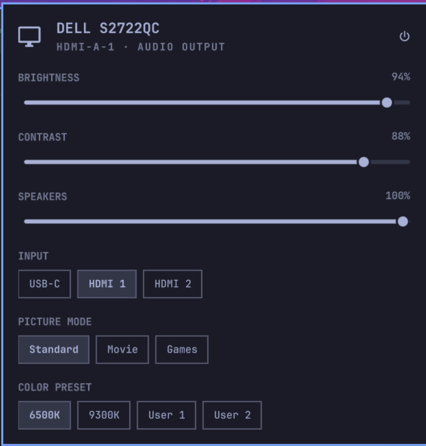

# omarchy-ddc: external monitor brightness, volume and input control for Omarchy

Control your external monitor from the [Omarchy](https://omarchy.org) bar:
brightness, contrast, built-in speaker volume, input source (HDMI, DisplayPort,
USB-C), picture mode, color preset, and power. It does what the buttons and
on-screen menu on the monitor do, without the buttons. Think
[BetterDisplay](https://github.com/waydabber/BetterDisplay),
[MonitorControl](https://github.com/MonitorControl/MonitorControl) or
[Lunar](https://lunar.fyi) on macOS, or
[Twinkle Tray](https://twinkletray.com) on Windows, for Omarchy on
Hyprland and Linux.



## Why

A laptop's own screen has a backlight the OS controls. An external monitor
keeps its brightness and volume inside itself, behind fiddly buttons. Most monitors accept the same settings over the video cable through
[DDC/CI](https://en.wikipedia.org/wiki/Display_Data_Channel), which
[ddcutil](https://www.ddcutil.com) speaks, and Omarchy already includes ddcutil.
This plugin puts it one click away.

Speaker volume is the one people miss most. When sound goes to the monitor
over HDMI or DisplayPort, the volume slider in Omarchy's Audio panel changes
the level of the signal. The monitor's own speaker volume stays where it was. The SPEAKERS slider here changes the monitor's side.

## Features

- One section per monitor that answers DDC/CI, all at once, not just the
  focused one.
- **Brightness, contrast, speaker volume** sliders.
- **Input source** switching: HDMI 1/2, DP 1/2, USB-C, VGA, DVI.
- **Picture mode** (Standard, Movie, Games…) and **color preset** (6500K,
  9300K, User…).
- **Turn the monitor off** (asks first: only the monitor's power button turns
  it back on).
- Marks the monitor your sound is playing on as AUDIO OUTPUT.
- Scroll on the bar icon to change the focused monitor's brightness, with
  Omarchy's brightness OSD. `h`/`l` do the same inside the panel.
- Each control shows only if the monitor advertises it. A monitor without
  speakers has no SPEAKERS slider.
- Finds monitors by their video connector (HDMI-A-1, DP-2), so two identical
  monitors are told apart, and re-scans when one is plugged in or out.

## Install

```sh
omarchy plugin add https://github.com/bunin/omarchy-ddc.git --enable
```

The icon (a monitor with a dashboard on its screen, 󰨇) appears in the bar once
a DDC/CI monitor is found. It pairs well with Omarchy's own Display widget, so
put it next to that one. Move it with a drag or `omarchy bar move bunin.ddc --section right`.

Remove it with `omarchy plugin remove bunin.ddc`.

Requirements, all present on a stock Omarchy install:

- ddcutil 2.x or later (in `omarchy-base`). Its udev rule gives the
  logged-in user access to the graphics card's i2c buses, with no group or
  sudo needed.
- A monitor with DDC/CI turned on. It usually is; if the icon never shows up,
  look for "DDC/CI" in the monitor's on-screen menu.

## Troubleshooting

See what ddcutil sees:

```sh
ddcutil detect                          # monitors that answer DDC/CI
ddcutil --bus 3 capabilities            # what one monitor supports
ddcutil --bus 3 getvcp 10 12 62 --brief # brightness, contrast, volume
```

- **No icon in the bar:** `ddcutil detect` lists the monitor as "Invalid
  display" or not at all. Turn on DDC/CI in the monitor menu. Docks, KVM
  switches and some USB-C adapters do not pass DDC/CI through.
- **A control is missing:** the monitor does not list that VCP code in its
  capabilities.
- **An input shows as 0x…:** a code outside the MCCS standard. Open an issue
  with the monitor model and the `ddcutil capabilities` output.
- **Slow sliders:** each DDC/CI read or write takes about half a second. The
  plugin sends only the latest position. A drag never queues up.

Tested on a Dell S2722QC over HDMI with an NVIDIA card. DisplayPort
multi-stream (daisy chains), docks and laptops are untested, and reports are
welcome.

## How it works

`Panel.qml` is a regular Omarchy shell bar widget. It runs ddcutil through one
queue, one call at a time, because two calls on the same i2c bus can corrupt
each other. `Model.js` parses ddcutil's output and labels values from the MCCS
2.2 tables.

| Control | VCP code |
| --- | --- |
| Brightness | `0x10` |
| Contrast | `0x12` |
| Color preset | `0x14` |
| Input source | `0x60` |
| Speaker volume | `0x62` |
| Power | `0xD6` |
| Picture mode | `0xDC` |

## Development

```sh
git clone https://github.com/bunin/omarchy-ddc.git
ln -sfn "$PWD/omarchy-ddc" ~/.config/omarchy/plugins/bunin.ddc
omarchy restart shell
QT_QPA_PLATFORM=offscreen /usr/lib/qt6/bin/qmltestrunner -input omarchy-ddc/tests/
```

The shell loads plugin QML once, so `omarchy restart shell` applies an edit.

## License

[MIT](./LICENSE)

<!-- Keywords: Omarchy plugin, Hyprland, Quickshell, Linux external monitor brightness, monitor volume control Linux, change monitor input from Linux, DDC/CI GUI, ddcutil GUI, ddcui alternative, BetterDisplay for Linux, MonitorControl for Linux, Twinkle Tray for Linux, Wayland monitor brightness -->
